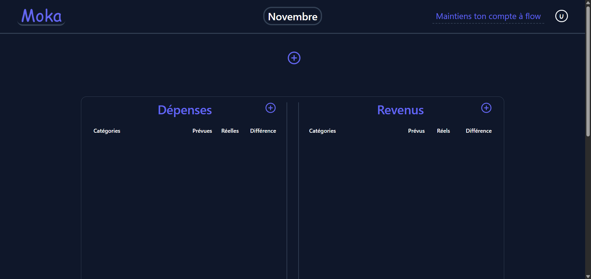

# Moka

Personal project to learn Java/Spring Boot and Angular :

Moka is a web application to manage monthly budget with 100% customizable income and expense categories. It also allows for the implementation of projects and semi-automatic management of their supplies. The application is based on a date specified by the user for overall budget managment.

## Installation

Pour l'instalation il est necessaire d'avoir **Docker** d'installé  
https://www.docker.com/get-started/

1. Clone Repository :

   ```bash
   git clone https://github.com/SagWel/Moka.git
   ```

2. Start **Docker Desktop** if you use windows

3. Start Docker service :

   ```bash
   docker-compose up -d --build
   ```

4. Go to Moka :

   http://localhost:8081/

## Technologies

- TailwindCSS
- Angular 21
- Java 21 / Spring Boot
- JsonWebToken
- Docker

## Features

1. Implemented
   -

2. In the future
   - add an account
   - reports on projected and actual expenses and revenue with charts
   - add an expense or income for budgets
   - add and edit transactions
   - add and edit projects
   - change the month
   - Smart investment suggestions for projects at the end of each month

## Tree Structure

Moka
├── README.md  
├── docker-compose.yml  
├── moka-api  
│ ├── DockerFile  
│ ├── HELP.md  
│ ├── mvnw  
│ ├── mvnw.cmd  
│ ├── pom.xml  
│ ├── src  
│ │ ├── main  
│ │ │ ├── java  
│ │ │ │ └── com  
│ │ │ │ └── moka  
│ │ │ │ ├── desktop.ini  
│ │ │ │ └── moka_api  
│ │ │ │ ├── MokaApiApplication.java  
│ │ │ │ ├── config  
│ │ │ │ │ └── SecurityConfig.java  
│ │ │ │ ├── controller  
│ │ │ │ │ ├── AccountController.java  
│ │ │ │ │ ├── AuthController.java  
│ │ │ │ │ ├── BudgetMonthController.java  
│ │ │ │ │ ├── CategoryController.java  
│ │ │ │ │ ├── ProjectController.java  
│ │ │ │ │ ├── TransactionController.java  
│ │ │ │ │ └── UserProfileController.java  
│ │ │ │ ├── desktop.ini  
│ │ │ │ ├── dto  
│ │ │ │ │ ├── AuthResponseDTO.java  
│ │ │ │ │ ├── LoginRequestDTO.java  
│ │ │ │ │ ├── RegisterRequestDTO.java  
│ │ │ │ │ └── UserProfileDTO.java  
│ │ │ │ ├── model  
│ │ │ │ │ ├── Account.java  
│ │ │ │ │ ├── BudgetMonth.java  
│ │ │ │ │ ├── Category.java  
│ │ │ │ │ ├── CategoryBudget.java  
│ │ │ │ │ ├── Project.java  
│ │ │ │ │ ├── Recurrence.java  
│ │ │ │ │ ├── Transaction.java  
│ │ │ │ │ ├── UserProfile.java  
│ │ │ │ │ └── enums  
│ │ │ │ │ ├── CategoryType.java  
│ │ │ │ │ ├── RecurrenceRate.java  
│ │ │ │ │ └── TransactionStatus.java  
│ │ │ │ ├── repository  
│ │ │ │ │ ├── AccountRepository.java  
│ │ │ │ │ ├── BudgetMonthRepository.java  
│ │ │ │ │ ├── CategoryRepository.java  
│ │ │ │ │ ├── ProjectRepository.java  
│ │ │ │ │ ├── TransactionRepository.java  
│ │ │ │ │ └── UserProfileRepository.java  
│ │ │ │ ├── security  
│ │ │ │ │ └── JwtAuthFilter.java  
│ │ │ │ └── service  
│ │ │ │ ├── AccountService.java  
│ │ │ │ ├── AuthService.java  
│ │ │ │ ├── BudgetMonthService.java  
│ │ │ │ ├── CategoryService.java  
│ │ │ │ ├── JwtService.java  
│ │ │ │ ├── ProjectService.java  
│ │ │ │ ├── TransactionService.java  
│ │ │ │ └── UserProfileService.java  
│ │ │ └── resources  
│ │ │ ├── application.properties  
│ │ │ ├── static  
│ │ │ └── templates  
│ │ └── test  
│ │ └── java  
│ │ └── com  
│ │ └── moka  
│ │ ├── desktop.ini  
│ │ └── moka_api  
│ │ ├── MokaApiApplicationTests.java  
│ │ └── desktop.ini  
│ └── target  
│ ├── classes  
│ │ ├── application.properties  
│ │ └── com  
│ │ └── moka  
│ │ ├── desktop.ini  
│ │ └── moka_api  
│ │ ├── MokaApiApplication.class  
│ │ ├── config  
│ │ │ └── SecurityConfig.class  
│ │ ├── controller  
│ │ │ ├── AccountController.class  
│ │ │ ├── AuthController.class  
│ │ │ ├── BudgetMonthController.class  
│ │ │ ├── CategoryController.class  
│ │ │ ├── ProjectController.class  
│ │ │ ├── TransactionController.class  
│ │ │ └── UserProfileController.class  
│ │ ├── desktop.ini  
│ │ ├── dto  
│ │ │ ├── AuthResponseDTO.class  
│ │ │ ├── LoginRequestDTO.class  
│ │ │ ├── RegisterRequestDTO.class  
│ │ │ └── UserProfileDTO.class  
│ │ ├── model  
│ │ │ ├── Account$AccountBuilder.class  
│       │               │   ├── Account.class  
│       │               │   ├── BudgetMonth$BudgetMonthBuilder.class  
│ │ │ ├── BudgetMonth.class  
│ │ │ ├── Category$CategoryBuilder.class  
│       │               │   ├── Category.class  
│       │               │   ├── CategoryBudget$CategoryBudgetBuilder.class  
│ │ │ ├── CategoryBudget.class  
│ │ │ ├── Project$ProjectBuilder.class  
│       │               │   ├── Project.class  
│       │               │   ├── Recurrence$RecurrenceBuilder.class  
│ │ │ ├── Recurrence.class  
│ │ │ ├── Transaction$TransactionBuilder.class  
│       │               │   ├── Transaction.class  
│       │               │   ├── UserProfile$UserProfileBuilder.class  
│ │ │ ├── UserProfile.class  
│ │ │ └── enums  
│ │ │ ├── CategoryType.class  
│ │ │ ├── RecurrenceRate.class  
│ │ │ └── TransactionStatus.class  
│ │ ├── repository  
│ │ │ ├── AccountRepository.class  
│ │ │ ├── BudgetMonthRepository.class  
│ │ │ ├── CategoryRepository.class  
│ │ │ ├── ProjectRepository.class  
│ │ │ ├── TransactionRepository.class  
│ │ │ └── UserProfileRepository.class  
│ │ ├── security  
│ │ │ └── JwtAuthFilter.class  
│ │ └── service  
│ │ ├── AccountService.class  
│ │ ├── AuthService.class  
│ │ ├── BudgetMonthService.class  
│ │ ├── CategoryService.class  
│ │ ├── JwtService.class  
│ │ ├── ProjectService.class  
│ │ ├── TransactionService.class  
│ │ └── UserProfileService.class  
│ ├── generated-sources  
│ │ └── annotations  
│ ├── generated-test-sources  
│ │ └── test-annotations  
│ ├── maven-archiver  
│ │ └── pom.properties  
│ ├── maven-status  
│ │ └── maven-compiler-plugin  
│ │ ├── compile  
│ │ │ └── default-compile  
│ │ │ ├── createdFiles.lst  
│ │ │ └── inputFiles.lst  
│ │ └── testCompile  
│ │ └── default-testCompile  
│ │ ├── createdFiles.lst  
│ │ └── inputFiles.lst  
│ ├── moka-api-0.0.1-SNAPSHOT.jar  
│ ├── moka-api-0.0.1-SNAPSHOT.jar.original  
│ ├── surefire-reports  
│ │ ├── TEST-com.moka.moka_api.MokaApiApplicationTests.xml  
│ │ └── com.moka.moka_api.MokaApiApplicationTests.txt  
│ └── test-classes  
│ └── com  
│ └── moka  
│ ├── desktop.ini  
│ └── moka_api  
│ ├── MokaApiApplicationTests.class  
│ └── desktop.ini  
└── moka-ui  
 ├── DockerFile  
 ├── README.md  
 ├── angular.json  
 ├── nginx.conf  
 ├── package-lock.json  
 ├── package.json  
 ├── public  
 │ ├── apple-touch-icon.png  
 │ ├── favicon-16x16.png  
 │ ├── favicon-32x32.png  
 │ └── site.webmanifest  
 ├── src  
 │ ├── app  
 │ │ ├── app.config.ts  
 │ │ ├── app.css  
 │ │ ├── app.html  
 │ │ ├── app.routes.ts  
 │ │ ├── app.scss  
 │ │ ├── app.spec.ts  
 │ │ ├── app.ts  
 │ │ ├── components  
 │ │ │ ├── account-summary  
 │ │ │ │ ├── account-summary.css  
 │ │ │ │ ├── account-summary.html  
 │ │ │ │ ├── account-summary.spec.ts  
 │ │ │ │ └── account-summary.ts  
 │ │ │ ├── category-budget-tables  
 │ │ │ │ ├── category-budget-tables.css  
 │ │ │ │ ├── category-budget-tables.html  
 │ │ │ │ ├── category-budget-tables.spec.ts  
 │ │ │ │ └── category-budget-tables.ts  
 │ │ │ ├── header  
 │ │ │ │ ├── header.css  
 │ │ │ │ ├── header.html  
 │ │ │ │ ├── header.spec.ts  
 │ │ │ │ └── header.ts  
 │ │ │ ├── modal  
 │ │ │ │ ├── modal.css  
 │ │ │ │ ├── modal.html  
 │ │ │ │ ├── modal.spec.ts  
 │ │ │ │ └── modal.ts  
 │ │ │ ├── project-dashboard  
 │ │ │ │ ├── project-dashboard.css  
 │ │ │ │ ├── project-dashboard.html  
 │ │ │ │ ├── project-dashboard.spec.ts  
 │ │ │ │ └── project-dashboard.ts  
 │ │ │ └── transaction-list  
 │ │ │ ├── transaction-list.css  
 │ │ │ ├── transaction-list.html  
 │ │ │ ├── transaction-list.spec.ts  
 │ │ │ └── transaction-list.ts  
 │ │ ├── models  
 │ │ │ └── models.ts  
 │ │ ├── pages  
 │ │ │ ├── home-page  
 │ │ │ │ ├── home-page.css  
 │ │ │ │ ├── home-page.html  
 │ │ │ │ ├── home-page.spec.ts  
 │ │ │ │ └── home-page.ts  
 │ │ │ └── profil-page  
 │ │ │ ├── profil-page.css  
 │ │ │ ├── profil-page.html  
 │ │ │ ├── profil-page.spec.ts  
 │ │ │ └── profil-page.ts  
 │ │ └── services  
 │ │ ├── account.spec.ts  
 │ │ ├── account.ts  
 │ │ ├── budget-month.spec.ts  
 │ │ ├── budget-month.ts  
 │ │ ├── category.spec.ts  
 │ │ ├── category.ts  
 │ │ ├── project.spec.ts  
 │ │ ├── project.ts  
 │ │ ├── transaction.spec.ts  
 │ │ └── transaction.ts  
 │ ├── index.html  
 │ ├── main.ts  
 │ ├── styles.css  
 │ └── styles.scss  
 ├── tsconfig.app.json  
 ├── tsconfig.json  
 └── tsconfig.spec.json

## Preview


